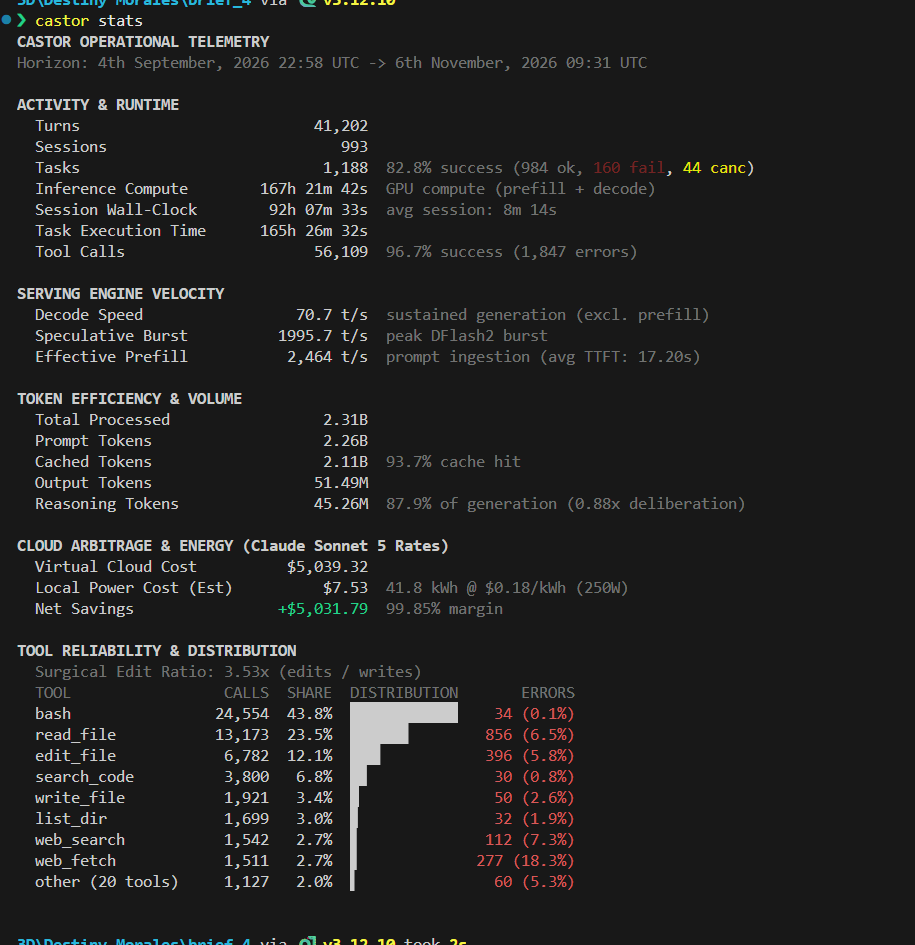

<div align="center">

<a href="#the-receipts">
  
</a>

# Castor

### Keep your frontier model. Stop paying it to read files.

Castor lets Claude Code, Antigravity, and Cursor hand the grunt work (reading, grepping, editing, running tests) to a model on **your own GPU**.<br>
The cloud model still does the thinking. Your cloud bill drops to almost nothing.

<p>
  <a href="https://www.npmjs.com/package/mcp-castor"></a>
  <a href=".github/workflows"></a>
  <a href="https://www.rust-lang.org/"></a>
  <a href="LICENSE"></a>
</p>

```bash
npx -y mcp-castor install --client all
```

<sub>One command. Registers with every MCP client it finds. No config file needed.</sub>

</div>

---

## Where your tokens actually go

Watch a cloud coding agent work and you'll see that **most of what you pay for isn't thinking.** It's the agent reading 20 files, grepping, running `cargo test`, and reading the logs. Then every one of those outputs gets **sent again and billed again on every later turn.**

Castor splits the job in two:

| | Cloud-only agent | **With Castor** |
|---|---|---|
| Planning & architecture | Frontier model | **Frontier model** (unchanged) |
| Reading, grepping, editing, testing | Frontier model, billed per token, every turn | **Your local GPU, \$0 in tokens** |
| What reaches the cloud | Every raw log and file dump | **Only the short, verified result** |
| Cloud context window | Fills up with terminal noise | **Stays clean** |

> **You keep frontier-quality planning. You stop paying frontier prices for `cat` and `grep`.**

---

## The receipts

These numbers come straight from `castor stats` on a real workstation, from **4 Sep to 6 Nov 2026**. They are not projections.

<div align="center">

| | |
|---:|:---|
| **\$5,039.32** | what the same workload would have cost at Claude Sonnet 5 API rates |
| **\$7.53** | what it actually cost: 41.8 kWh of GPU electricity |
| **\$5,031.79** | saved in 63 days, a **99.85% margin** |
| **2.31 B** | tokens processed locally instead of billed |
| **41,202** | agent turns across 993 sessions |
| **96.7%** | tool-call success rate across 56,109 calls |
| **93.7%** | KV prefix-cache hit rate, so repeated context stays warm |

</div>

<details>
<summary><b>See the raw telemetry screenshot</b></summary>
<br>

</details>

Run `castor stats` yourself and you'll get the same breakdown for your own usage.

---

## See it work

<div align="center">
<a href="https://raw.githubusercontent.com/ApatheticMioz/Castor/main/docs/assets/demo.mp4">
  
</a>
<sub>The cloud model plans → Castor runs the edit-and-test loop locally → a short, verified result goes back. <a href="https://raw.githubusercontent.com/ApatheticMioz/Castor/main/docs/assets/demo.mp4">Watch in 1080p60</a>.</sub>
</div>

---

## Why engineers trust it

- **Built in Rust and fast.** Tool calls run in-process in under 0.1 ms, with no network round trip per `grep`.
- **Sandboxed by default.** A zero-trust containment pipeline blocks path escapes, symlink tricks, and destructive shell commands before anything runs.
- **Hard to wedge.** A pre-flight check rejects oversized "mega-prompts". A token-budgeted scheduler keeps concurrent tasks from overloading your VRAM. A stream guard kills runaway output loops.
- **No polling bill.** Long tasks hand back a wait hook, so your cloud agent sleeps for \$0 and wakes up the moment the work is done.
- **Works with what you already run.** Any OpenAI-compatible engine works, and it's auto-detected.

<div align="center">

| Cloud clients | Local engines |
|:---:|:---:|
| Claude Code · Google Antigravity · Cursor · Claude Desktop · any MCP client | vLLM · llama.cpp · LM Studio · SGLang · Ollama · any OpenAI-compatible `/v1` |

</div>

---

## Get started in 60 seconds

**1. Install**

```bash
npx -y mcp-castor install --client all
```

**2. Point it at your engine.** If your engine is on the default `127.0.0.1:18020`, Castor finds it automatically. If not:

```bash
export CASTOR_BASE_URL="http://127.0.0.1:1234/v1"   # e.g. LM Studio
```

**3. Ask your cloud agent as usual**

> *"Refactor the auth middleware to use JWT and verify with `cargo test` using castor."*

That's it. For engine profiles, manual MCP config, and per-engine notes, see **[Getting Started](docs/getting-started.md)**.

---

## Documentation

| | |
|---|---|
| 🚀 **[Getting Started](docs/getting-started.md)** | Install, manual MCP config, engine setup, supported clients and engines |
| 🧠 **[Architecture](docs/architecture.md)** | DGI firewall, zero-turn lifecycle, token-budget semaphore, stream proxy, Evo, MCP tool surface |
| 🛡️ **[Security](docs/security.md)** | The zero-trust workspace containment pipeline |
| ⌨️ **[CLI & Development](docs/cli.md)** | Command reference, building from source, test gate |
| ⚙️ **[Engine Profiles](docs/engine-profiles.md)** · **[llama.cpp](docs/llama-cpp.md)** | Serving-engine tuning and managed `llama-server` |

---

## License

**[AGPL-3.0](LICENSE)** open source. Network-deployed modifications must publish their source.

**Commercial dual-licensing** is available for proprietary embedding without copyleft obligations. Contact [`ApatheticMioz@gmail.com`](mailto:ApatheticMioz@gmail.com).
