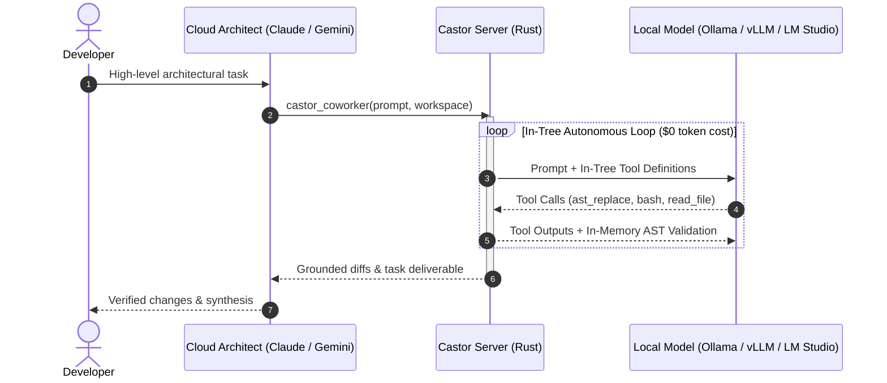
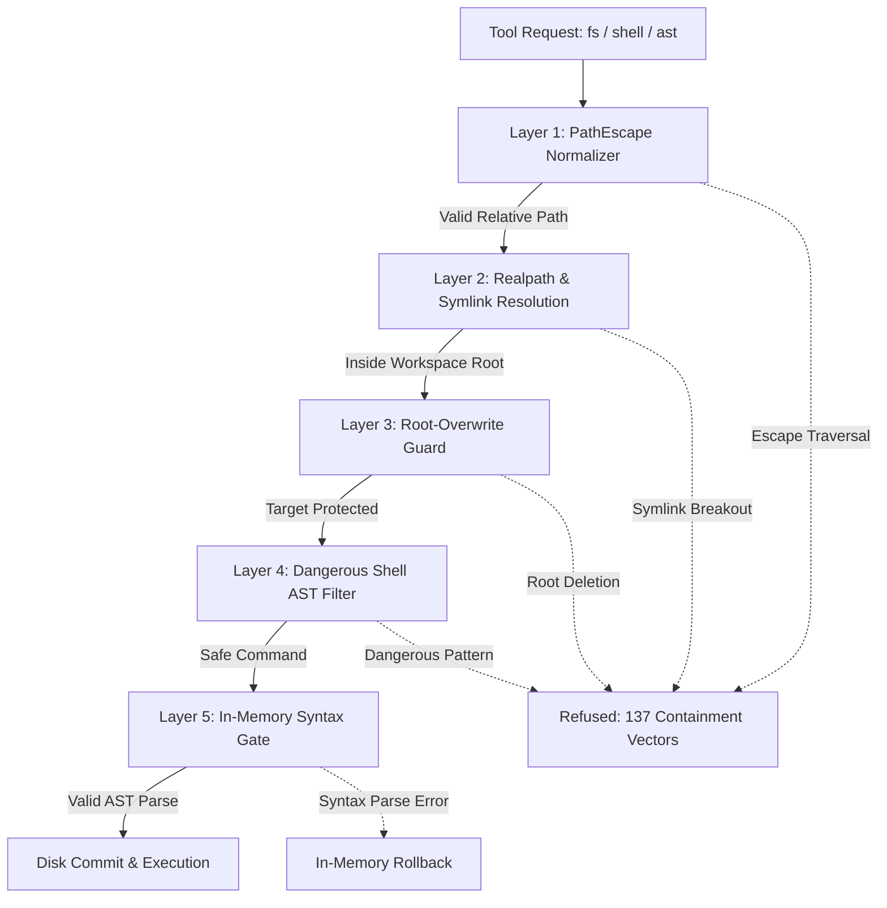

<div align="center">


# Castor

<p><b>Universal Cloud-to-Local Agent Bridge & MCP Microkernel in Rust</b></p>

<p>Pair cloud orchestrators (Claude Code, Google Antigravity) with local execution models (Ollama, vLLM, LM Studio) at <b>$0 token cost</b>.</p>

<p>
<a href="#testing--verification"></a>
<a href="https://www.npmjs.com/package/mcp-castor"></a>
<a href="https://www.rust-lang.org/"></a>
<a href="LICENSE"></a>
<a href="#testing--verification"></a>
</p>

<a href="https://raw.githubusercontent.com/ApatheticMioz/Castor/main/docs/assets/demo.mp4"></a>

<sub>Zero tool output tokens enter cloud context. In-process dispatch & 93.9% KV cache hit across 53 days of production telemetry.
<a href="https://raw.githubusercontent.com/ApatheticMioz/Castor/main/docs/assets/demo.mp4">1080p60 MP4</a></sub>

</div>

---

## Quickstart

### 1. Install & Register (1 Command)

Register Castor automatically with all detected MCP clients (Claude Code, Claude Desktop, Antigravity IDE):

```bash
# Run directly via npx
npx -y mcp-castor install --client all

# Or install globally
npm install -g mcp-castor
castor install --client all
```

Or configure manually in your MCP client configuration (`claude_desktop_config.json` or `mcp_config.json`):

```json
{
  "mcpServers": {
    "castor": {
      "command": "npx",
      "args": ["-y", "mcp-castor", "mcp"]
    }
  }
}
```

### 2. Connect Your Local Model

Castor connects to any OpenAI-compatible local endpoint. By default, it looks for `http://127.0.0.1:18020/v1`:

```bash
# Ollama (port 11434)
export CASTOR_BASE_URL="http://127.0.0.1:11434/v1"
export CASTOR_MODEL="qwen2.5-coder:32b"

# LM Studio (port 1234)
export CASTOR_BASE_URL="http://127.0.0.1:1234/v1"
export CASTOR_MODEL="qwen3.8-27b"

# vLLM (default port 18020)
export CASTOR_BASE_URL="http://127.0.0.1:18020/v1"
export CASTOR_MODEL="Qwen3.8-27B"

# llama.cpp (llama-server --alias castor-coder --port 18020 --jinja)
export CASTOR_ENGINE_TYPE="llama.cpp"
export CASTOR_BASE_URL="http://127.0.0.1:18020/v1"
export CASTOR_MODEL="castor-coder"
```

See the [llama.cpp guide](docs/llama-cpp.md) for managed startup/shutdown,
Windows and Linux examples, GGUF models, tool calling, and optional live tests.

Configuration persists in `~/.castor/config.json` and respects `CASTOR_*` environment variable overrides.

---

## System Architecture

Cloud coding agents (Claude Code, Gemini 3.8 Flash, Cursor) excel at system-level reasoning and planning, but reading thousands of lines of repository context or executing repetitive edit-and-test loops inflates cloud token costs and latency.

Castor provides an **in-process Rust execution server** as a Model Context Protocol (MCP) server. It splits work between cloud planning and local hands-on execution:

```text
  Developer
      │
      ▼
  Cloud Architect (Claude / Gemini / Antigravity)
      │
      │  MCP tool dispatch: castor_coworker(prompt, cwd)
      ▼
  Castor Server (Local Rust Execution Server over stdio)
      │
      ├─── 16 in-tree tools: read_file, write_file, edit_file, list_dir,
      │    search_code, ast_search, ast_replace, git_status/diff/log/commit,
      │    python_repl, paper_lookup, web_search, web_fetch, bash
      │    └── Validated against sandbox boundaries & AST syntax gates
      │
      ▼  Inference requests over HTTP (:18020)
  Local Serving Engine (vLLM / Ollama / LM Studio)
      │
      ▼  Grounded diffs & test results returned
  Cloud Architect synthesizes final output
```

<details>
<summary><b>Mermaid Diagram Source (for supported viewers)</b></summary>



</details>

### Key Principles

- **Zero Cloud Token Hoarding**: The Lead Architect (cloud) directs tasks and reviews diffs without loading thousands of source lines into expensive prompt context.
- **In-Process Tool Dispatch Speed**: Filesystem operations and structural AST mutations execute in-process (<0.1 ms dispatch) without subprocess spawning overhead.
- **Zero-Turn Reactive Wait**: Long-running background jobs yield an OS-level wait hook (`curl :18021/task/<id>/wait`). Cloud supervisors block at **$0 token cost** and resume immediately upon task completion.

---

## Sandboxed Workspace Confinement

Castor enforces a **5-layer defense-in-depth boundary** ensuring neither coworker models nor external agents can escape the workspace root:

```text
  Tool Request (fs / shell / ast)
     │
     ▼
  [ Layer 1: Path Normalizer ] ─────── (escape traversal) ──► REFUSED
     │ (valid path)
     ▼
  [ Layer 2: Symlink Realpath ] ────── (out-of-tree link) ──► REFUSED
     │ (inside workspace)
     ▼
  [ Layer 3: Root-Overwrite Guard ] ── (root deletion) ────► REFUSED
     │ (target protected)
     ▼
  [ Layer 4: Shell Command Filter ] ── (dangerous cmd) ────► REFUSED
     │ (safe command)
     ▼
  [ Layer 5: In-Memory Syntax Gate ] ─ (syntax parse error) ► ROLLBACK
     │ (valid AST parse)
     ▼
  Disk Commit & Tool Output
```

<details>
<summary><b>Mermaid Flowchart Source (for supported viewers)</b></summary>



</details>

1. **PathEscape Normalizer**: Neutralizes directory traversal (`../../`), drive escapes (`C:\`), and device namespaces (`NUL`, `CON`).
2. **Symlink Realpath Containment**: Resolves canonical symlink targets to prevent out-of-tree escapes.
3. **Workspace Root Guard**: Blocks accidental or malicious deletion of the workspace root or parent folders.
4. **Dangerous Shell Filter**: AST validator blocks destructive commands (`rm -rf /`, `format`, fork bombs, `dd`).
5. **In-Memory Syntax Gate**: Validates syntactical integrity (Rust, TypeScript, JavaScript, Python, JSON) before disk commits, rolling back automatically on errors.

*Regression-tested against a 137-vector automated containment suite (123 attack vectors blocked, 14 allow vectors).*

---

## Consolidated MCP Interface

Castor registers three stdio tools across any MCP client:

| Tool | Purpose | Primary Actions & Parameters |
|---|---|---|
| **`castor_coworker`** | Hands-on execution & peer programming | Dispatches a prompt to the sandboxed 16 builtin-tool runtime: `read_file`, `write_file`, `edit_file`, `list_dir`, `search_code`, `ast_search`, `ast_replace`, `git_status`, `git_diff`, `git_log`, `git_commit`, `python_repl`, `paper_lookup`, `web_search`, `web_fetch`, `bash`. |
| **`castor_task`** | Background task control & telemetry | Actions: `status`, `cancel`, `cancel_all`, `list`, `stats`, `extend_lease`. |
| **`castor_server`** | Local inference engine supervisor | Actions: `status`, `start`, `stop`. Manages engine boots, health canaries, and auto-healing. |

### The 16 Built-in Coworker Tools

`castor_coworker` runs inside a sandboxed runtime exposing exactly these 16
in-tree tools (defined in `src/tools/mod.rs`):

| Tool | Capability |
|---|---|
| `read_file` | Read source, PDFs (native in-memory extraction), and images for local visual inspection. |
| `write_file` | Create or overwrite a file (sandboxed to the workspace). |
| `edit_file` | Exact-substring, uniqueness-guarded edit with in-memory AST validation before commit. |
| `list_dir` | Directory listing with depth control. |
| `search_code` | Text/pattern search across the workspace. |
| `ast_search` | Structural AST search via native ast-grep. |
| `ast_replace` | Structural AST replace with automatic rollback on syntax error. |
| `git_status` | Short working-tree status. |
| `git_diff` | Staged or unstaged diff. |
| `git_log` | Recent commit history. |
| `git_commit` | Stage paths and commit. |
| `python_repl` | Stateful Python REPL scratchpad for computation and data analysis. |
| `paper_lookup` | Verified academic metadata via OpenAlex (titles, venues, DOIs, affiliations, OA PDFs). |
| `web_search` | Meta-search via SearXNG with Brave fallback. |
| `web_fetch` | Fetch and convert HTML/PDF/plain text to clean Markdown. |
| `bash` | Isolated shell with a 5-layer dangerous-command filter. |

---

## CLI Command Reference

```bash
# Model Context Protocol stdio server (default)
castor mcp

# Automatically register with MCP clients
castor install --client <all|claude|antigravity>

# Display operational telemetry dashboard
castor stats [-s 24h] [-d] [-j]

# Inspect effective configuration hierarchy
castor config

# Manage local inference engine lifecycle
castor server <status|start|stop>

# Clean stale sessions, leases, and tasks per retention policy
castor clean [--yes]

# Run zero-turn HTTP status and wait endpoint (:18021)
castor status

# Run universal SSE streaming proxy (:18022)
castor proxy
```

---

## Operational Telemetry (`castor stats`)

Castor maintains an append-only JSONL event ledger in `~/.castor/sessions/*/events.jsonl`. Running `castor stats` compiles a live terminal dashboard summarizing token efficiency and local execution metrics:

```bash
# View dashboard with full terminal formatting
castor stats

# Filter by time horizon (e.g., last 24 hours, 7 days)
castor stats -s 24h

# Output machine-readable JSON for monitoring
castor stats -j
```

---

## Building from Source

```bash
# Prerequisites: Rust >= 1.85 (2024 edition)
git clone https://github.com/ApatheticMioz/Castor.git
cd Castor

# Build binary
cargo build --release

# Run the offline verification gate (unit + integration, deterministic mock/replay harnesses)
cargo test --all-features

# Register local release build with clients
./target/release/castor install --client all
```

---

## Testing & Verification

Castor maintains a strict zero-warning and offline verification gate:

```bash
# Offline test gate (unit + integration, deterministic mock/replay harnesses; no running engine)
cargo test --all-features

# Strict clippy lint gate (zero warnings enforced)
cargo clippy --all-targets --all-features -- -D warnings
```

The live GPU tests (`tests/llama_cpp.rs`, `tests/bonsai_deep_eval.rs`) are
`#[ignore]`-gated and opt-in via `ALLOW_ENGINE_INTERRUPT=1`; they never run
in the default suite.

---

## Repository Structure

```
Castor/
  Cargo.toml                # Root crate manifest (dual-target: lib + bin; features: mcp, evals, evo, full)
  package.json              # npm distribution manifest (bin/castor.js)
  bin/castor.js             # Cross-platform Node.js execution shim
  skills/                   # Reusable SKILL.md recipes
  src/
    lib.rs                  # Library crate root (public modules & embeddings)
    main.rs                 # CLI entry point (delegates to castor::cli)
    cli.rs                  # Clap command line parsing & execution routing
    config.rs               # Unified serde config (env > config.json > defaults)
    platform.rs             # Cross-OS path translation and process trees
    skills.rs               # agentskills.io SKILL.md indexer
    telemetry.rs            # JSONL event ledger & derived statistics
    pruner.rs               # State dir retention pruner
    state/                  # State dir layout, locks, session persistence
    mcp/                    # rmcp stdio transport, tool schemas, DGI probe, worker
    task/                   # Task registry, long-poll wait (:18021), semaphore
    proxy/                  # Stream proxy (:18022), SSE sanitizer, loop breaker
    engine/                 # Provider interface, backend, lifecycle, supervisor, detached
    runner/                 # Multi-turn autonomous loop & event ledgers
    tools/                  # 16 builtin tools: fs, ast, git, repl, web, paper, shell, sandbox
    evals/                  # Offline replay harness (fixture, replay, runner)
    evo/                    # Evolutionary optimizer & lineage DAG
  evals/                    # Tier A offline replay, golden test tasks, DGI datasets
  docs/                     # Active specifications (engine profiles, llama.cpp guide)
```

---

## License & Inquiries

Licensed under the **[GNU Affero General Public License v3 (AGPL-3.0)](LICENSE)**.

- **Open Source**: Free software under AGPLv3. Network-deployed modifications must make source code available.
- **Commercial Dual-Licensing**: Available for proprietary embedding without copyleft obligations. Inquiries: [`ApatheticMioz@gmail.com`](mailto:ApatheticMioz@gmail.com).
