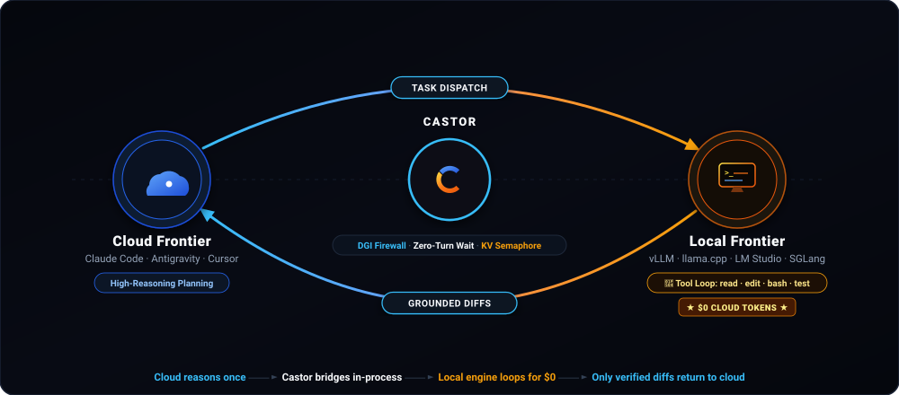

<div align="center">


# Castor

**The bridge between the cloud frontier and the local frontier.**

Pair high-reasoning cloud orchestrators (Claude Code, Google Antigravity, Cursor) with locally-served execution models at **$0 cloud token cost**.

<p>
  <a href=".github/workflows"></a>
  <a href="https://www.npmjs.com/package/mcp-castor"></a>
  <a href="https://www.rust-lang.org/"></a>
  <a href="LICENSE"></a>
  <a href="#building--verification"></a>
</p>

<p>
  <a href="https://raw.githubusercontent.com/ApatheticMioz/Castor/main/docs/assets/demo.mp4">
    
  </a>
  <br>
  <sub>
    <b>Watch:</b> Cloud orchestrator dispatches a prompt → Castor microkernel drives the local serving
    engine through the in-tree tool loop → concise deliverable returns to the cloud.
    <a href="https://raw.githubusercontent.com/ApatheticMioz/Castor/main/docs/assets/demo.mp4">1080p60 MP4</a>.
  </sub>
</p>

</div>

---

## Quickstart

### 1. Install & Register

Register Castor with every detected MCP client in one command:

```bash
# One-shot, no global install required:
npx -y mcp-castor install --client all

# …or install globally first:
npm install -g mcp-castor
castor install --client all
```

Prefer manual wiring? Drop this into your client's MCP config (`claude_desktop_config.json`, `~/.gemini/config/mcp_config.json`, or your Cursor MCP file):

```json
{
  "mcpServers": {
    "castor": {
      "command": "npx",
      "args": ["-y", "mcp-castor", "mcp"]
    }
  }
}
```

### 2. Connect Your Local Engine

Castor auto-discovers any OpenAI-compatible endpoint at `http://127.0.0.1:18020/v1` by probing
`/v1/models` — it detects the model name, context window (`max_model_len`), and engine backend
(vLLM / llama.cpp / LM Studio / SGLang / Ollama) automatically. No config file, no env vars.

For custom endpoints or non-default ports, set `CASTOR_BASE_URL`:

```bash
# LM Studio (port 1234)
export CASTOR_BASE_URL="http://127.0.0.1:1234/v1"

# vLLM (custom port)
export CASTOR_BASE_URL="http://127.0.0.1:8000/v1"

# SGLang / Ollama / any other OpenAI-compatible /v1
export CASTOR_BASE_URL="http://127.0.0.1:<port>/v1"
```

See [docs/llama-cpp.md](docs/llama-cpp.md) for managed `llama-server` startup/shutdown and
Windows/Linux examples. Configuration persists to `~/.castor/config.json`; env vars always win.

### 3. Pair Program at $0

Prompt your cloud agent like this:

> *"Refactor auth middleware to use JWT and verify with `cargo test` using castor."*

The cloud architect plans. Castor executes the edit-and-test loop against the local model —
in-tree, at **$0 cloud token cost**. Only the concise, verified deliverable returns to the cloud.

---

## Why Castor?

| Dimension | Pure Cloud Agent | Local Model Alone | **Castor Dual-Agent** |
|---|---|---|---|
| **Architectural reasoning** | Top-tier | Limited by model size / capability | **Cloud frontier** (Claude, Gemini, Antigravity, Cursor) |
| **Hands-on tool loop** | Every `read_file` / grep / compiler log is re-sent & re-billed at cloud rates per turn | Runs locally but with limited planning quality | **Local serving engine — $0 cloud tokens** |
| **Cost per tool iteration** | Cloud API (billed per token, every turn) | ~$0 (but weak planning) | **~$0 cloud cost** — only the final deliverable crosses the wire |
| **Context window pressure** | Grows with every file read, grep, log | Same | Isolated to local model |
| **Latency** | Network round-trip per turn | Local | **Local** (in-process dispatch) |
| **Safety & containment** | Varies by vendor | DIY | **Zero-trust workspace sandbox** (path / symlink / root / shell / AST) |

**The core insight:** In a cloud-only agent, every tool output — reading 20 files, running
`cargo test`, grepping the tree — is re-sent and re-billed at cloud rates on every subsequent
turn. Castor inverts this: tool loops execute **in-tree against the local serving engine at
$0 cloud cost**. Only concise, verified deliverables (diffs, test verdicts, task summaries)
return to the cloud.

---

## System Architecture



**Flow:**

1. **Cloud Architect** (Claude Code, Google Antigravity, Cursor) plans and dispatches a
   prompt via the MCP tool `castor_coworker(prompt, cwd)`.
2. **stdio MCP transport** carries the request to the **Castor Microkernel** — a local
   Rust execution server with an in-process 8-tool core and a zero-trust sandbox.
3. **Castor → Local Serving Engine** over HTTP (`:18020`). The engine (vLLM / llama.cpp /
   LM Studio / SGLang / Ollama) runs the in-tree tool loop — reading, editing, grepping,
   `cargo test`, Python — at **$0 cloud token cost**.
4. The **concise, verified deliverable** returns to the cloud architect for synthesis.

For long tasks, the microkernel yields a durable task ID and a long-poll wait hook on
`:18021` so the cloud supervisor sleeps at $0 and wakes the millisecond execution
completes (see § *Zero-Turn Reactive Lifecycle* below).

---

## Core Innovations

### 1. DGI (Decomposition Granularity Index)

A **pre-execution firewall** that stops compound "mega-prompt" thrashing before it burns
compute or leases a slot. A **1-forward-pass logit probe** (sub-25 ms on vLLM via `guided_choice`;
scales with decode speed on llama.cpp) against the serving engine classifies the
dispatch prompt; the decision rule is:

```
delta_z = logP(OVERLOADED) − logP(ADMIT)
REJECT  if delta_z > 1.5
```

Near-tie margins are routed to an advisory review rather than silent admission.
**Warm sessions** (continuations of an already-warm context) bypass the probe entirely —
$0 cost, zero extra round-trip. The probe is **engine-agnostic**: vLLM uses a
`guided_choice` single-token completion; llama.cpp uses a schema-constrained JSON chat
decode. Same decision rule, DRY request-builder / verdict-decoder core in
[`src/mcp/dgi.rs`](src/mcp/dgi.rs).

### 2. Zero-Turn Reactive Lifecycle

Tasks exceeding the sync window (default **15 s**, tunable via `CASTOR_SYNC_TIMEOUT_SECS`)
yield a durable task ID and a long-poll HTTP wait hook:

```bash
curl -N "http://127.0.0.1:18021/task/<task-id>/wait"
```

The cloud supervisor can block on that URL at **$0 token cost** and wakes reactively the
millisecond execution completes — no poll storms, no prompt re-sends.
Implemented in [`src/task/`](src/task/).

### 3. Token-Budget Semaphore & Cooperative Yielding

Zero-lock daemon. Slot admission is a **two-phase atomic `O_EXCL` lease**
(claim → ownership-check release), with **zombie-aware Linux PID liveness**
(via `/proc/{pid}/status`, `State: Z` is treated as dead so stale leases are reclaimed).

The admission budget is expressed in **tokens against the aggregate KV pool**
(`pool_capacity_tokens`). When pressure builds, the **cooperative yield gate**
(`pool_yield_gate`) lets younger sessions voluntarily yield to older ones —
preventing GPU VRAM thrashing under concurrency spikes.
See [`src/task/semaphore.rs`](src/task/semaphore.rs).

### 4. Stream Proxy & Sanitizer

A real-time SSE proxy that watches live model output on `:18022` for pathological behaviour:

- **UTF-8 packet-fragment reassembly** — safe multi-byte / emoji boundaries across
  TCP chunks.
- **Repetition circuit breaker** — halts mid-stream degenerate loops (identical
  content repeating within a rolling window) before they burn the whole context.
- **Multimodal guards** — filters image / tool payload shapes that would corrupt
  the downstream parser.

See [`src/proxy/`](src/proxy/).

### 5. Evolutionary Optimizer (Evo)

Closed-loop code mutation guided by an **append-only, cycle-proof lineage DAG**
(`src/evo/`). Each mutation is gated on a **deterministic test fitness** evaluation;
a **stagnation watchdog** (`src/evo/watchdog.rs`) inspects the DAG head and flags
plateaus so the loop can be reset before drift accumulates.

### 6. Lean 8-Tool Core

Eight tools in the core runtime — no bloat:

```
read_file · write_file · edit_file · list_dir · search_code · bash · web_search · web_fetch
```

`git status / diff / log / commit` and ad-hoc `python3` run natively through `bash` —
no separate git tool, no Python subprocess shim. Two **feature gates** extend the
core for power users:

- `ast` — structural `ast_search` / `ast_replace` via ast-grep, with automatic rollback on syntax error.
- `paper` — `paper_lookup` against OpenAlex for verified academic metadata.

### 7. Lazy Skills Engine

Standard [`agentskills.io`](https://agentskills.io) `SKILL.md` catalog. Skills are
**indexed in the system prompt** (just name + one-line summary) and **loaded on
demand** — the full body is only injected when the current task matches. This keeps
the **Turn-1 KV prefix cache warm and stable** across tasks in the same workspace,
so a new prompt reuses the prior KV prefix instead of re-prefilling it.

---

## Workspace Containment


Castor enforces **zero-trust containment** at every tool boundary:

| Layer | Mechanism | What it blocks |
|---|---|---|
| **1 — Path normalizer** | Canonical path resolution & device namespace neutralization | `../../etc/passwd`, `C:\`, `NUL`, `CON` |
| **2 — Symlink realpath** | Resolves canonical `realpath` of every target before acting | Symlinks pointing out of the workspace root |
| **3 — Out-of-tree guard** | Enforces workspace boundary (`refuse_out_of_tree`) | Direct mutations targeting system or parent directories |
| **4 — Dangerous command filter** | Signature & pattern blocks on shell commands (`shell.rs`) | `rm -rf /`, `format`, `dd`, fork bombs, `mkfs`, shell injection bypasses |
| **5 — In-memory AST syntax gate** | Structural AST parser validation on `ast_replace` | Syntax parse errors on Rust / TS / JS / Python / JSON → **automatic in-memory rollback** |

File edits in `fs.rs` use atomic fsync writes via `NamedTempFile` preventing torn states;
structural mutations via `ast_replace` pass Layer 5 **before** the disk commit, atomically
rolling back on syntax parse failure.

---

## MCP Tool Surface

Castor registers **three stdio MCP tools** with any client:

| MCP Tool | Purpose | Actions / Parameters |
|---|---|---|
| **`castor_coworker`** | Hands-on execution & peer programming | `prompt`, `cwd` — dispatches into the sandboxed 8-tool runtime + feature-gated `ast` / `paper` |
| **`castor_task`** | Background task control & telemetry | `status` · `cancel` · `cancel_all` · `list` · `stats` · `extend_lease` |
| **`castor_server`** | Local serving-engine supervisor | `status` · `start` · `stop` — managed engine lifecycle with health canaries and auto-healing |

**Lean 8-tool core** (plus feature-gated extensions):

| Tool | Feature Gate | Capability |
|---|---|---|
| `read_file` | core | Read files, PDFs (native in-memory extraction), and images (PNG/JPG/WebP/GIF/BMP) |
| `write_file` | core | Create or overwrite files (sandboxed to the workspace) |
| `edit_file` | core | Exact-substring edit, uniqueness-guarded, atomic tempfile replacement |
| `list_dir` | core | Directory listing with depth control |
| `search_code` | core | Deterministic path-filtered text/regex search across the workspace |
| `bash` | core | Isolated shell with the 5-layer filter; native `git` and `python3` |
| `web_search` | core | Meta-search (SearXNG primary, Brave fallback) |
| `web_fetch` | core | Fetch & convert HTML / PDF / plain text to clean Markdown |
| `ast_search` | `ast` | Structural AST search via ast-grep (metavariables `$VAR`, `$$$ARGS`) |
| `ast_replace` | `ast` | Structural AST replace with automatic rollback on syntax error |
| `paper_lookup` | `paper` | Verified academic metadata via OpenAlex (title, DOI, affiliations, OA PDFs) |

---

## Ecosystem Matrix

**Supported Cloud Clients**

| Client | Registration |
|---|---|
| **Claude Code** | `castor install --client claude` |
| **Google Antigravity** | `castor install --client antigravity` (writes `~/.gemini/config/mcp_config.json`) |
| **Claude Desktop** | `claude_desktop_config.json` (manual or via installer) |
| **Cursor** | Cursor MCP config (manual) |
| **Any MCP client** | stdio MCP — the JSON snippet in *Quickstart §1* works everywhere |

**Supported Serving Engines**

| Engine | Default Port | Notes |
|---|---|---|
| **vLLM** | 18020 | `owned_by: "vllm"` auto-detected via `/v1/models`; `guided_choice` DGI probe |
| **llama.cpp** (`llama-server`) | 18020 | `owned_by: "llama.cpp"`; `--jinja` for tool-calling; managed start/stop via `castor server` |
| **LM Studio** | 1234 | Override `CASTOR_BASE_URL` |
| **SGLang** | 30000 | Override `CASTOR_BASE_URL` |
| **Ollama** | 11434 | Override `CASTOR_BASE_URL` |
| **Any OpenAI-compatible `/v1` endpoint** | any | Set `CASTOR_BASE_URL` |

Auto-detection reads `/v1/models` (model name, `max_model_len`) and wire-level
fingerprints (`/health`, `/version`, `owned_by`) to pick the right engine profile
without any user configuration.

---

## CLI Reference

```bash
# Model Context Protocol stdio server (default entry point)
castor mcp

# Register with MCP clients (claude | antigravity | all)
castor install --client all

# Manage the local serving engine lifecycle (status | start | stop)
castor server start

# Operational telemetry dashboard (JSONL event ledger → live TUI)
castor stats [-s 24h] [-d] [-j]

# Inspect effective configuration (env > config.json > defaults)
castor config

# Clean stale sessions, leases, and tasks per retention policy
castor clean [--yes]
```

Additional subcommands available: `castor status` (zero-turn HTTP wait server on
`:18021`) and `castor proxy` (SSE stream proxy on `:18022`) — see
[`src/cli.rs`](src/cli.rs) for the full surface.

---

## Building & Verification

```bash
# Prerequisites: Rust ≥ 1.85 (2024 edition)
git clone https://github.com/ApatheticMioz/Castor.git
cd Castor

# Release build
cargo build --release

# Offline test gate (unit + integration; deterministic mock/replay harnesses —
# no running engine required; live GPU tests are #[ignore]-gated behind
# ALLOW_ENGINE_INTERRUPT=1 and never run in this suite)
cargo test --all-features

# Strict Clippy gate (zero warnings enforced)
cargo clippy --all-targets --all-features -- -D warnings
```

Both gates run in CI; a PR that fails either is not mergeable.

---

## License & Inquiries

Licensed under the **[GNU Affero General Public License v3.0 (AGPL-3.0)](LICENSE)**.

- **Open Source**: Free software under AGPLv3. Network-deployed modifications must make source code available.
- **Commercial Dual-Licensing**: Available for proprietary embedding without copyleft obligations. Inquiries: [`ApatheticMioz@gmail.com`](mailto:ApatheticMioz@gmail.com).
