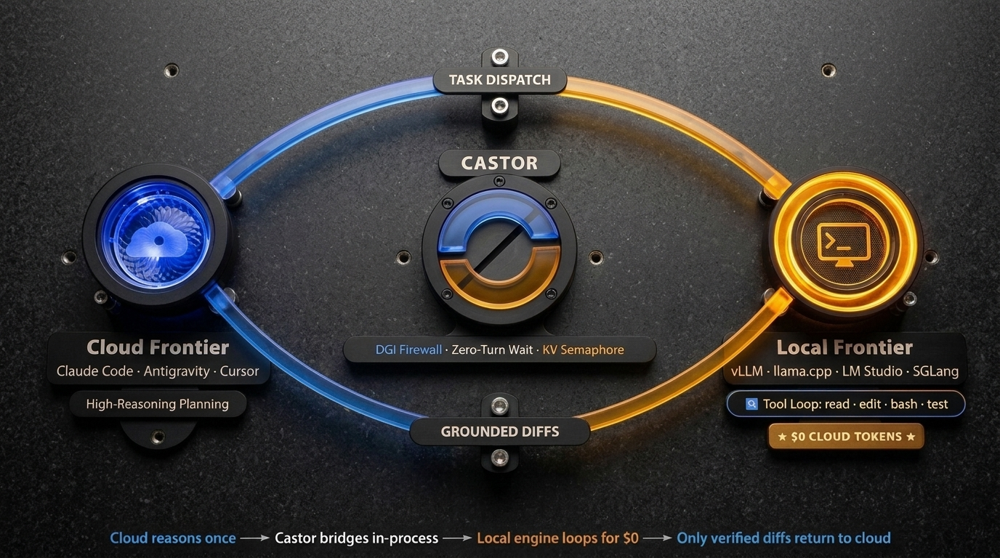
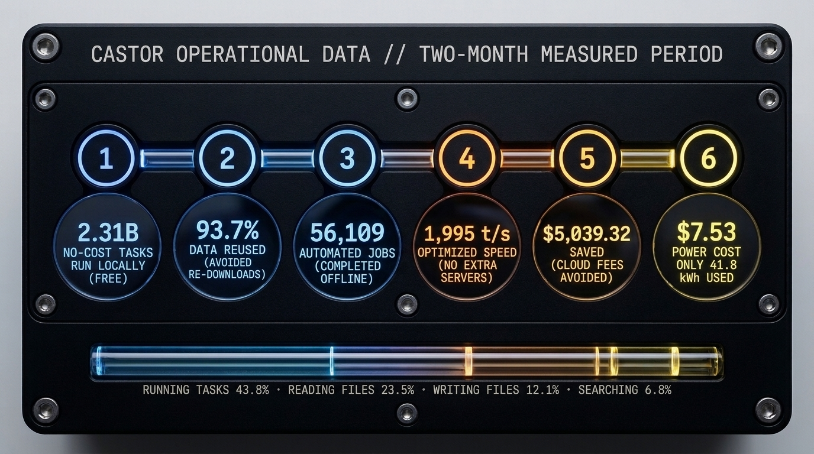
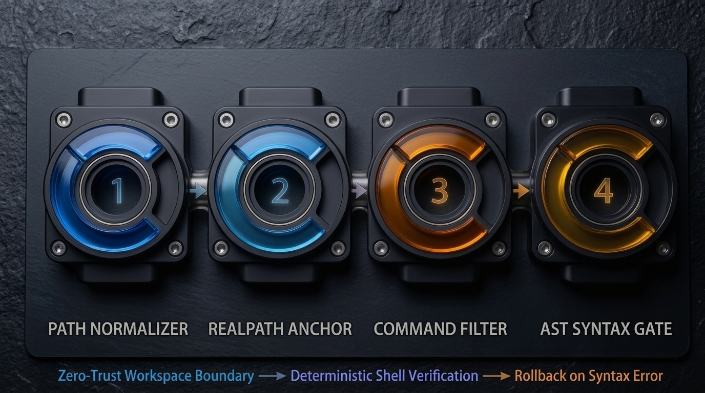

https://github.com/user-attachments/assets/c4111e31-e8f5-4d3b-b139-b4a1ff46a48c

<div align="center">


# CASTOR

**In-Process Local Execution Microkernel for Frontier Cloud Agents**

`Rust 2024` · `MCP over stdio` · `< 0.08 ms Tool Dispatch` · `AGPL-3.0`

```bash
npx -y mcp-castor install --client all
```

<sub>Registers `castor_coworker`, `castor_task`, and `castor_server` across Claude Code, Google Antigravity, and Cursor in one command.</sub>

</div>

<br>

<div align="center">
  <video src="docs/assets/final.mp4" autoplay loop muted playsinline width="100%"></video>
  <p>
    <sub>
      <b>Plate I — The Dioscuri Ring Cavity (<code>18020 // 0.08ms</code>).</b> Upper sapphire arc (Pollux): high-reasoning cloud supervision. Lower sodium-amber arc (Castor): high-frequency local execution on port <code>:18020</code> with sub-<code>0.08 ms</code> in-process Rust tool dispatch.
    </sub>
  </p>
</div>

---

## I. The Dichroic Split: Supervisory Reasoning vs. Local Execution

In a conventional cloud coding session, the frontier model does not merely architect—it acts as an expensive terminal multiplexer. It reads twenty files, runs `grep`, executes `cargo test`, ingests thousands of lines of compiler output, and **re-transmits that entire accumulated payload on every subsequent turn**. You pay frontier reasoning rates to transport raw file bytes and stdout noise.

Castor bifurcates the agent loop across two distinct execution media:

<div align="center">
  
  <p>
    <sub>
      <b>Plate II — Three-Station Signal Topology.</b> A single supervisory task crosses the Castor microkernel bridge, executes a multi-turn in-process tool loop against local silicon for $0 in cloud tokens, and returns only a grounded, verified diff.
    </sub>
  </p>
</div>

| Dimension | Monolithic Cloud Agent | **Castor Dichroic Architecture** |
| :--- | :--- | :--- |
| **Supervisory Architecture & Decomposition** | Frontier cloud model | **Frontier cloud model** (Claude Code, Antigravity, Cursor) |
| **Exploration, File Surgery, AST Refactoring & Test Loops** | Frontier cloud model — billed per input/output token on every turn | **Local GPU serving engine (`:18020`) — \$0.00 token cost** |
| **Tool Execution Latency** | Network round-trip + container IPC per call | **In-process Rust execution (`< 0.08 ms`)** |
| **Long-Running Task Synchronization** | Repeated cloud polling turns | **Zero-turn HTTP long-poll wait hook (`:18021`) at \$0.00** |
| **Payload Returned to Cloud Context** | Full raw file dumps, grep traces, and test logs | **Compact, verified diff and ground-truth summary** |

### Microkernel Port & Subsystem Topology

- **Port `:18020` — Local Serving Engine:** Connects to any OpenAI-compatible `/v1` inference backend (`vLLM`, `llama.cpp`, `SGLang`, `LM Studio`, `Ollama`). Auto-discovers the active model and `max_model_len` at boot.
- **Port `:18021` — Zero-Turn Long-Poll Status Server:** Tasks exceeding 15 seconds yield a deterministic HTTP wait endpoint (`/task/<id>/wait?timeout_s=3600`). The cloud orchestrator blocks in the background at zero token cost and wakes the instant local execution terminates.
- **Port `:18022` — Loopback SSE Sanitization Proxy:** Reassembles fragmented UTF-8 byte streams, enforces per-turn reasoning budgets, and halts pathological repetition loops before they corrupt the session transcript.
- **DGI Logit Firewall & KV Slot Semaphore:** Pre-flight Decomposition Granularity Index (DGI) 1-forward-pass logit probing rejects overloaded mega-prompts before prefill, while a file-backed cross-process semaphore budgets aggregate tokens against the engine's KV pool (`max_context`).

---

## II. 63-Day Operational Telemetry

The following measurements were recorded by `castor stats` from an append-only JSONL production ledger on a single workstation between **4 September 2026** and **6 November 2026** (63 operational days across 993 sessions and 41,202 agent turns).

<div align="center">
  
  <p>
    <sub>
      <b>Plate III — Six-Register Operational Telemetry Console.</b> Audited directly from <code>~/.castor</code> session ledgers. Run <code>castor stats</code> at any time to inspect your own workstation's arbitrage ledger.
    </sub>
  </p>
</div>

| Register | Measured Value | Physical & Economic Meaning |
| :---: | ---: | :--- |
| **1** | **2.31 B tokens** | Total volume processed locally (`2.26 B` prompt tokens + `51.49 M` output tokens, of which `45.26 M` were deliberation tokens) at \$0.00 API cost. |
| **2** | **93.7% cache hit** | `2.11 B` prompt tokens served directly from warm local KV prefix cache via deterministic Turn-1 workspace skeletons and zero-invalidation retries. |
| **3** | **56,109 tool calls** | Executed in-process at a **96.7% success rate** (`bash` 43.8%, `read_file` 23.5%, `edit_file` 12.1%, `search_code` 6.8%, `write_file` 3.4%, `list_dir` 3.0%). |
| **4** | **1,995.7 t/s burst** | Peak DFlash2 speculative decoding velocity (`70.7 t/s` sustained generation excluding prefill; `2,464 t/s` effective prompt prefill). |
| **5** | **\$5,039.32** | Equivalent API expenditure avoided at benchmark Claude Sonnet 5 input/cache/output rates. |
| **6** | **\$7.53 (`41.8 kWh`)** | Actual local workstation electricity consumed (`167h 21m` active GPU compute at 250 W, billed at \$0.18/kWh) — a **99.85% net savings margin (\$5,031.79 saved)**. |

---

## III. Four-Stage Zero-Trust Containment & AST Verification

Local autonomous execution requires a deterministic hardware-grade boundary. Every filesystem read, edit, and shell command passes through a four-stage containment interlock before touching disk or spawning a process:

<div align="center">
  
  <p>
    <sub>
      <b>Plate IV — Four-Stage Containment Interlock.</b> Path normalization, symlink realpath anchoring, lexical shell command scanning, and in-memory tree-sitter AST verification with automatic rollback on syntax error.
    </sub>
  </p>
</div>

1. **Stage 1 — Lexical Path Normalizer:** Rejects null bytes, unexpanded tilde references, Windows reserved device names (`CON`, `NUL`, `COM1`), and collapses relative `..` segments prior to filesystem resolution.
2. **Stage 2 — Realpath Workspace Anchor:** Canonicalizes the workspace root and resolves all symlink chains to verify that the physical target resides strictly inside the sandbox boundary. Binary assets (`.png`, `.jpg`, `.exe`) are intercepted by magic-number sniffing (`BinaryFileError`) so raw bytes never pollute plaintext buffers, while PDFs are parsed into UTF-8 text in memory.
3. **Stage 3 — Lexical Command Filter:** Segments and tokenizes every `bash` invocation to block destructive primitives (`rm -rf` on protected roots, raw device `dd`, fork bombs, privilege escalation wrappers, and unexpanded variable escapes) before process spawn.
4. **Stage 4 — In-Memory AST Syntax Gate:** Under the `ast` feature, `edit_file` and `ast_replace` reparse the modified buffer in memory via native `tree-sitter` / `ast-grep` grammars before committing to disk. Any `ERROR` or `UNDEFINED` syntax node aborts the write and rolls back the transaction cleanly.

---

## IV. Commissioning & Reference Manuals

### 1. Install and Register with MCP Clients

```bash
npx -y mcp-castor install --client all
```

### 2. Bind to Your Local Serving Engine

If your engine listens on the default `http://127.0.0.1:18020/v1`, Castor discovers its model identifier and context length automatically. To target another local endpoint (such as LM Studio, Ollama, or a custom vLLM port):

```bash
export CASTOR_BASE_URL="http://127.0.0.1:1234/v1"
```

### 3. Dispatch from Your Cloud Architect

> *"Refactor the task semaphore module to track per-slot context tokens and verify with `cargo test --all-features` via castor."*

| Supported Cloud Orchestrators | Supported Local Serving Engines |
| :--- | :--- |
| Claude Code · Google Antigravity · Cursor · Claude Desktop · Any stdio MCP client | `vLLM` · `llama.cpp` · `SGLang` · `LM Studio` · `Ollama` · Any OpenAI-compatible `/v1` server |

### Technical Documentation Index

| Manual | Scope |
| :--- | :--- |
| **[Getting Started](docs/getting-started.md)** | Client installation, manual MCP JSON configuration, environment variables, and first dispatch |
| **[Architecture](docs/architecture.md)** | DGI 1-forward-pass logit firewall, zero-turn `:18021` wait lifecycle, token-budgeted KV semaphore, `:18022` SSE proxy, and Evo optimizer |
| **[Security Boundary](docs/security.md)** | Five-layer zero-trust path containment, binary magic-number guards, lexical shell scanner, and AST rollback guarantees |
| **[CLI & Development](docs/cli.md)** | Subcommands (`castor mcp`, `castor server`, `castor stats`), feature flags (`ast`, `paper`, `evo`), and offline test gates |
| **[Engine Profiles](docs/engine-profiles.md)** · **[llama.cpp Guide](docs/llama-cpp.md)** | Auto-discovery rules, user-defined `~/.castor/config.json` profiles, KV cache sizing, and managed `llama-server` supervision |

---

## License

Published under the **[GNU Affero General Public License v3.0 (AGPL-3.0)](LICENSE)**. Network-deployed or hosted modifications must disclose their complete corresponding source code.

For commercial dual-licensing permitting proprietary embedding without copyleft obligations, contact [`ApatheticMioz@gmail.com`](mailto:ApatheticMioz@gmail.com).
