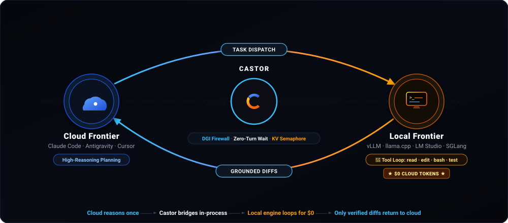

# Architecture



## Flow

1. **Cloud Architect** (Claude Code, Google Antigravity, Cursor) plans and dispatches a
   prompt via the MCP tool `castor_coworker(prompt, cwd)`.
2. **stdio MCP transport** carries the request to the **Castor Microkernel**, an in-process
   Rust runtime providing an 8-tool core and zero-trust workspace containment.
3. **Castor → Local Serving Engine** over HTTP (`:18020`). The engine (vLLM, llama.cpp,
   LM Studio, SGLang, Ollama) executes the tool loop (reading, editing, grepping, running tests)
   at **$0 cloud token cost**.
4. The **concise, verified deliverable** returns to the cloud architect for final synthesis.

For long tasks, the microkernel yields a durable task ID and a long-poll wait hook on
`:18021` so the cloud supervisor sleeps at $0 and wakes the millisecond execution
completes (see *Zero-Turn Reactive Lifecycle* below).

### Why the split matters

| Dimension | Pure Cloud Agent | Local Model Alone | **Castor Dual-Agent** |
|---|---|---|---|
| **Architectural reasoning** | Top-tier | Limited by model size & context | **Cloud frontier** (Claude, Gemini, Antigravity, Cursor) |
| **Hands-on tool loop** | Every file read, grep, and log re-billed at cloud rates | Runs locally with limited planning quality | **Local serving engine ($0 cloud tokens)** |
| **Cost per iteration** | Cloud API billed per token every turn | ~$0 (weak planning) | **~$0 cloud cost** (only verified deliverables cross the wire) |
| **Context window load** | Grows rapidly with raw terminal dumps & logs | Same | Isolated entirely to local engine context |
| **Loop latency** | Network round-trip per tool invocation | Local | **Local in-process tool dispatch** |
| **Safety & containment** | Vendor-dependent | DIY | **Zero-trust workspace containment pipeline** |

In a cloud-only agent, every tool output (reading 20 files, running `cargo test`, grepping the codebase) is re-sent and re-billed at cloud rates on every subsequent turn. Castor inverts this: the hands-on tool loop executes in-tree against the local serving engine at **$0 cloud cost**, returning only verified deliverables to the cloud.

---

## Core Components

### 1. DGI (Decomposition Granularity Index)

A **pre-execution firewall** that stops compound "mega-prompt" thrashing before it burns
compute or leases a slot. A **1-forward-pass logit probe** (sub-25 ms on vLLM via `guided_choice`;
scales with decode speed on llama.cpp) against the serving engine classifies the
dispatch prompt; the decision rule is:

```
delta_z = logP(OVERLOADED) − logP(ADMIT)
REJECT  if delta_z > 1.5
```

Near-tie margins are routed to an advisory review rather than silent admission.
**Warm sessions** (continuations of an already-warm context) bypass the probe entirely with
zero overhead. The probe is **engine-agnostic**: vLLM uses a `guided_choice` single-token
completion; llama.cpp uses a schema-constrained JSON chat decode. Same decision rule,
DRY request-builder and verdict-decoder core in [`src/mcp/dgi.rs`](../src/mcp/dgi.rs).

### 2. Zero-Turn Reactive Lifecycle

Tasks exceeding the sync window (default **15 s**, tunable via `CASTOR_SYNC_TIMEOUT_SECS`)
yield a durable task ID and a long-poll HTTP wait hook:

```bash
curl -N "http://127.0.0.1:18021/task/<task-id>/wait"
```

The cloud supervisor blocks on that URL at **$0 token cost** and wakes reactively the
millisecond execution completes without polling loops or prompt re-sends.
Implemented in [`src/task/`](../src/task/).

### 3. Token-Budget Semaphore & Cooperative Yielding

Zero-lock daemon. Slot admission is a **two-phase atomic `O_EXCL` lease**
(claim → ownership-check release), with **zombie-aware Linux PID liveness**
(via `/proc/{pid}/status`, `State: Z` is treated as dead so stale leases are reclaimed).

The admission budget is expressed in **tokens against the aggregate KV pool**
(`pool_capacity_tokens`). When pressure builds, the **cooperative yield gate**
(`pool_yield_gate`) lets younger sessions voluntarily yield to older ones,
preventing GPU VRAM thrashing under concurrency spikes.
See [`src/task/semaphore.rs`](../src/task/semaphore.rs).

### 4. Stream Proxy & Sanitizer

A real-time SSE proxy that monitors live model output on `:18022` for degenerate stream patterns:

- **UTF-8 packet-fragment reassembly**: Guarantees safe multi-byte and emoji boundaries across TCP chunks.
- **Repetition circuit breaker**: Halts mid-stream degenerate loops (identical content repeating within a rolling window) before context exhaustion.
- **Payload guards**: Filters malformed tool and image payloads before they reach the parser.

See [`src/proxy/`](../src/proxy/).

### 5. Evolutionary Optimizer (Evo)

Closed-loop code mutation guided by an **append-only, cycle-proof lineage DAG**
(`src/evo/`). Each mutation is gated on a **deterministic test fitness** evaluation;
a **stagnation watchdog** (`src/evo/watchdog.rs`) inspects the DAG head and flags
plateaus so the loop can be reset before drift accumulates.

### 6. Lean 8-Tool Core

Eight core tools cover all workspace execution without bloat:

```
read_file · write_file · edit_file · list_dir · search_code · bash · web_search · web_fetch
```

Git operations (`git status`, `diff`, `log`, `commit`) and ad-hoc Python run natively through `bash`. Two optional feature gates extend capabilities for specialized workflows:

- `ast`: Structural `ast_search` and `ast_replace` via ast-grep with automatic syntax rollback.
- `paper`: Academic paper lookup (`paper_lookup`) against OpenAlex for verified research metadata and open-access PDFs.

### 7. Lazy Skills Engine

Compatible with the [`agentskills.io`](https://agentskills.io) `SKILL.md` standard. Skills are
indexed in the system prompt with just their name and summary, and loaded on demand only when
the active task requires them. This preserves the **Turn-1 KV prefix cache** across tasks in the
same workspace so repeat prompts avoid full re-prefill penalties.

---

## MCP Tool Surface

Castor registers three stdio MCP tools:

| MCP Tool | Purpose | Actions / Parameters |
|---|---|---|
| **`castor_coworker`** | Hands-on execution & peer programming | `prompt`, `cwd` — dispatches into the sandboxed 8-tool runtime + feature-gated `ast` / `paper` |
| **`castor_task`** | Background task control & telemetry | `status` · `cancel` · `cancel_all` · `list` · `stats` · `extend_lease` |
| **`castor_server`** | Local serving-engine supervisor | `status` · `start` · `stop` — managed engine lifecycle with health canaries and auto-healing |

### Tool Reference

| Tool | Feature Gate | Capability |
|---|---|---|
| `read_file` | core | Read files, PDFs (in-memory text extraction), and images (PNG/JPG/WebP/GIF/BMP) |
| `write_file` | core | Create or overwrite files within the workspace root |
| `edit_file` | core | Exact-substring edit with uniqueness checks and atomic tempfile replacement |
| `list_dir` | core | Directory listing with optional depth control |
| `search_code` | core | Deterministic path-filtered text and regex search |
| `bash` | core | Sandboxed shell with lexical command filter; native `git` and `python3` |
| `web_search` | core | Web meta-search (SearXNG primary, Brave Search fallback) |
| `web_fetch` | core | Fetch and convert HTML, PDF, or plaintext into clean Markdown |
| `ast_search` | `ast` | Structural AST search via ast-grep (metavariables `$VAR`, `$$$ARGS`) |
| `ast_replace` | `ast` | Structural AST refactoring with automatic rollback on syntax error |
| `paper_lookup` | `paper` | Academic metadata via OpenAlex (titles, DOIs, affiliations, open-access PDFs) |
