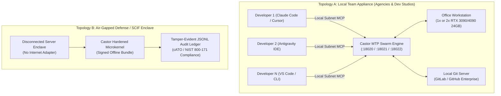

# Castor: Commercial & On-Premises Deployment Guide

> **Audience**: Enterprise DevSecOps Leads, CISO Teams, Engineering Directors, and Offshore Software Development Studios.  
> **Applicability**: DoD CMMC Level 2 enclaves, ITAR/CUI environments, FinTech/Healthcare, and private software house workstations.

---

## 1. Executive Summary

Castor provides an in-process, zero-trust autonomous agent microkernel that turns on-premises GPU infrastructure into an uncapped, 24/7 software engineering team. By pairing with local OpenAI-compatible serving engines (such as vLLM or llama.cpp) running Qwen3.8-27B with Multi-Token Prediction (MTP), Castor delivers:

- **280 tok/s Sustained Throughput** across 4 concurrent developer streams.
- **$0 Marginal API Cost**: Eliminates token meters ($500–$2,000/developer/month cloud API charges).
- **Zero Network Egress by Construction**: Verified 5-layer path containment and zero outbound network calls, fully compliant with DoD CMMC Level 2, ITAR, and client NDAs.
- **In-Memory AST Syntax Verification**: Pre-validates every code modification via tree-sitter before disk commit, preventing repository breakage.

---

## 2. Supported Deployment Topologies



### Topology A: Local Team Appliance (Software Agencies)
- **Target**: Boutique software engineering houses (10–50 developers) in regions like Pakistan, India, Eastern Europe, and LatAm.
- **Hardware Requirement**: A single shared workstation equipped with 1x or 2x NVIDIA RTX 3090 / 4090 (24GB VRAM each).
- **Connectivity**: Local office LAN. Developers connect over stdio or local network MCP without internet access.
- **Outcome**: Replaces expensive cloud seats, saves $1,500–$5,000 monthly, and enables agencies to market "Zero-Egress Client IP Protection" to international clients.

### Topology B: Air-Gapped Defense Enclave (CMMC Level 2 & SCIF)
- **Target**: DoD contractors, aerospace firms, intelligence enclaves, and sovereign government agencies.
- **Hardware Requirement**: Certified on-premises server (1U/2U rackmount with NVIDIA A100/H100/L40S or RTX 6000 Ada).
- **Connectivity**: 100% disconnected / air-gapped network with physical network isolation.
- **Outcome**: Restores autonomous AI coding capabilities to developers inside classified or compliance-restricted enclaves where commercial cloud assistants (Claude, Copilot) are legally banned.

---

## 3. 48-Hour Turnkey Deployment Checklist

For teams participating in our **48-Hour Turnkey Swarm Setup Sprint**:

### Step 1: Pre-Flight Hardware Verification
- GPU with $\ge 24\text{ GB}$ VRAM (NVIDIA CUDA Compute Capability $\ge 8.6$).
- Host OS: Windows 11 with WSL2 (Ubuntu 22.04/24.04) or native Enterprise Linux (RHEL 9 / Rocky Linux / Ubuntu Server).
- Storage: 100 GB fast NVMe SSD for model weights and KV cache swap space.

### Step 2: Serving Engine Initialization
Deploy the HyperQwen MTP serving recipe via the unified launcher:
```bash
# In WSL2 or Native Linux:
bash scripts/wsl/start_swarm.sh
```
This launcher automatically initializes:
- `Qwen3.8-27B-W4A16-AutoRound-fast` (27B dense model quantized to ~17GB VRAM).
- `SPEC=mtp`, `DRAFT_TOKENS=3` (Multi-Token Prediction delivering 280 tok/s burst).
- `MAX_SEQS=4`, `MAX_LEN=150000` (4 concurrent streams with 150k context window).
- `PREFIX_CACHE=1` (PagedAttention prefix caching for warm workspace prompts).

### Step 3: Castor Microkernel Configuration
Set the local endpoint environment in `~/.castor/config.json`:
```json
{
  "base_url": "http://127.0.0.1:18020/v1",
  "api_key": "local-token",
  "model": "auto",
  "max_concurrent_tasks": 4,
  "max_context": 150000,
  "workspace_skeleton": true
}
```

### Step 4: IDE & Client Integration
Register Castor across developer machines:
```bash
# Auto-register with Claude Code and Antigravity IDE:
castor install --client all
```
The client now dispatches tasks directly into Castor's 5-layer containment sandbox.

---

## 4. Compliance & Verification Guarantees

Every commercial deployment includes:
1. **Zero-Egress Network Verification**: Automated audit script testing all process network sockets (`netstat`, `ss`, `lsof`) confirming zero outbound TCP/UDP traffic to public IP ranges.
2. **NIST SP 800-171 & CMMC Level 2 Attestation Pack**: Pre-mapped controls for System & Information Integrity (SI.L2-3.14.1) and Access Control (AC.L2-3.1.1).
3. **Tamper-Evident Event Ledger**: An append-only JSONL session log (`~/.castor/telemetry/`) recording every tool invocation, AST diff, and execution timestamp for compliance assessors.

---

## 5. Commercial Licensing & Support

- **Community Core**: Open source under AGPLv3.
- **Turnkey Setup Sprint**: $1,500 fixed-fee deployment including on-site/remote GPU tuning, Git integration, and a 14-day 75% API cost reduction guarantee.
- **Team Appliance License**: $49 / developer / month (includes shared multi-user slot semaphore and real-time Web HUD).
- **Enterprise Air-Gap License**: $25,000 / year / enclave (includes signed offline bundles, zero-egress legal attestation, and 24/7 dedicated engineering SLA).

*Inquiries & Pilot Bookings*: `sales@castor-ai.com` | `https://castor-technologies.vercel.app`
